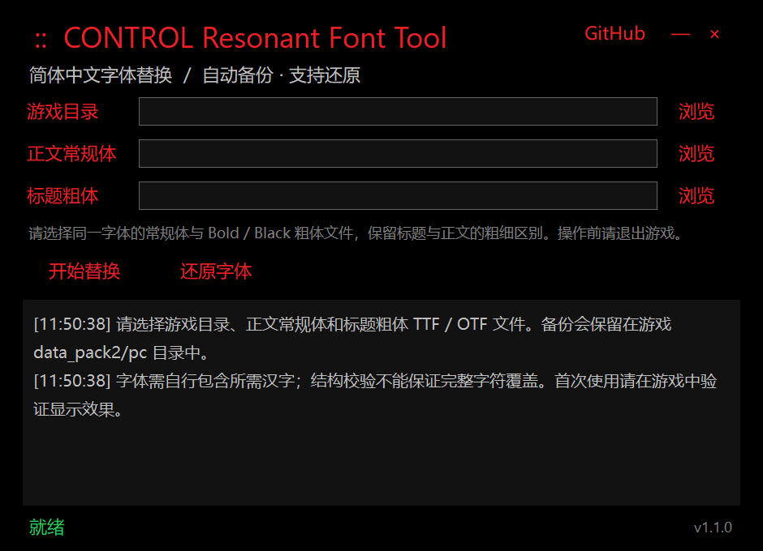

# CONTROL Resonant Font Tool

简体中文 | [English](#english)

独立的《控制：共振》（CONTROL Resonant）简体中文字体替换工具，提供红黑界面、自动备份和字体还原功能。

[](https://github.com/jakeouyang/ControlResonantFontTool/releases)
[](LICENSE)



## 下载

前往 [Releases](https://github.com/jakeouyang/ControlResonantFontTool/releases) 下载最新版压缩包，解压后直接运行 `ControlResonantFontTool.exe`。无需同目录 DLL 或额外安装运行环境，运行所需的原生组件会自动释放到系统临时缓存。

## 使用方法

1. 退出游戏，选择游戏根目录或 `data_pack2/pc`。
2. 分别选择同一字体的两个独立 TTF / OTF 文件：“正文常规体”选择 Regular / Normal，“标题粗体”选择 Bold / Heavy / Black。点击“开始替换”，两个文件分别写入游戏的 Regular 与 Black 简中字体槽位，保留粗细区别。
3. 点击“还原字体”恢复当前游戏版本首次替换前的状态。请保留游戏 `data_pack2/pc` 下的 `_fonttool_backup` 文件夹。

支持 TTF 和含 CFF 轮廓的 OTF，不支持 TTC 字体集合。字体结构校验不代表完整汉字覆盖，请在游戏中确认显示效果。

请使用字体本身提供的不同字重文件。工具按所选文件原样写入，不会自动加粗；两个选项使用相同内容时会提示没有粗细区别。可直接在旧版替换结果上重新选择两份字体执行替换，无需手动还原。还原功能同时恢复两个槽位。

## 备份与兼容

- 已有兼容备份会自动沿用并统一目录名称，无需手动改名。发现多份可能冲突的备份时，程序会停止操作，保留所有备份。
- 没有可用的替换记录时无法还原。请确认选择了正确的游戏目录，并保留完整备份。
- 游戏更新后再次替换时，若当前资源校验通过且索引已不再引用本工具的字体资源，旧备份会自动移至 `_fonttool_backup.archived-*`，并为当前版本建立新备份，无需删除备份或 `.fonttool.lock`。归档和旧字体资源保留。此校验不代表官方原版认证，其他工具的有效修改会成为当前备份的一部分。
- 若此前使用的工具生成了不同格式的备份，请使用当时的工具恢复该次修改。
- 包含简中字体的开发包 MOD 可能覆盖本工具的替换效果，使用前请先停用冲突的字体 MOD。
- 更新后点击还原，满足上述校验条件时仅归档旧记录、保留当前游戏文件；若仍引用旧字体补丁或资源不完整则停止，请验证游戏文件后重试。不同格式的 `_fontmod_backup` 历史备份冲突仍需手动处理。

本工具直接更新基础资源索引，使用独立字体资源文件；不生成开发包 MOD，不覆盖或截断原游戏资源包，也不修改其他工具。

## 从源码构建

需要 .NET 9 SDK（Windows）：

```bash
dotnet publish -c Release
```

产物为单文件自包含的 `ControlResonantFontTool.exe`。发布时 GitHub Actions 会自动构建并上传到 Releases：推送 `v*` 标签即可触发。

## 验证情况

已通过隔离环境中的双字重分别回读、资源顺序无关性、无效粗体拒绝、重复替换、还原一致性、游戏更新兼容、异常中断恢复及备份冲突检查。此前单字体导出内容也由独立解析器验证。双字重的游戏内显示效果尚未验证，欢迎通过 [Issues](https://github.com/jakeouyang/ControlResonantFontTool/issues) 反馈。

## 许可证

本项目基于 [MIT License](LICENSE) 开源。

---

# English

Standalone Simplified Chinese font replacement tool for CONTROL Resonant, with a red-and-black interface, automatic backup, and restore.


## Download

Get the latest archive from [Releases](https://github.com/jakeouyang/ControlResonantFontTool/releases) and run `ControlResonantFontTool.exe`. No companion DLLs or additional runtime installation are required; native runtime components are automatically extracted to the system temporary cache.

## Usage

1. Close the game, select its root folder or `data_pack2/pc`.
2. Select two standalone TTF/OTF files from the same font family: Regular / Normal for the body field (正文常规体), and Bold / Heavy / Black for the title field (标题粗体). Click Replace. They are written separately to the SC Regular and Black slots to preserve the weight difference.
3. Click Restore to roll back to the state before the first replacement for the current game version. Keep the `_fonttool_backup` folder under `data_pack2/pc`.

TTF and OTF with CFF outlines are supported; TTC collections are not. Structural validation does not guarantee full glyph coverage — verify in-game rendering.

Use distinct weights supplied by the font family. Files are written unchanged; the tool does not synthesize bold. Identical font contents produce a warning that there will be no weight difference. You can replace an existing single-font patch directly with the two selected fonts. Restore recovers both slots together.

## Backup & Compatibility

- Existing compatible backups are recognized and migrated automatically; ambiguous backups block the operation without touching either copy.
- Restore requires a complete replacement record and backup.
- After an update, a valid current index with no remaining references to this tool's font blobs becomes the new baseline. Old backups are preserved in `_fonttool_backup.archived-*`; old font blobs are retained. No manual deletion of backups or `.fonttool.lock` is needed. Validation does not certify an official unmodified installation; valid changes from other tools become part of the new baseline.
- Backups produced by other tools in a different format must be restored with the tool that created them.
- Development mods containing SC fonts may override this tool's replacement; disable conflicting font mods first.
- Restore after an update archives the stale record and preserves current files when the same checks pass. Remaining patch references or incomplete resources block the operation; verify game files and retry. Conflicting legacy `_fontmod_backup` backups still require manual handling.

The tool patches the base resource index and uses a standalone font blob; it does not create development mods, never overwrites or truncates original game blobs, and does not modify other tools.

## Building from Source

Requires the .NET 9 SDK on Windows:

```bash
dotnet publish -c Release
```

The output is a self-contained single-file `ControlResonantFontTool.exe`. GitHub Actions builds and attaches artifacts to Releases automatically on `v*` tag pushes.

## Validation

Isolated checks passed for distinct weight readback, resource-order independence, invalid bold rejection, repeated replacement, restore consistency, update compatibility, interrupted-transaction recovery, and backup conflicts. Earlier single-font exports were also verified by an independent parser. In-game rendering of the two-font patch has not been verified — feedback via [Issues](https://github.com/jakeouyang/ControlResonantFontTool/issues) is welcome.

## License

Released under the [MIT License](LICENSE).
